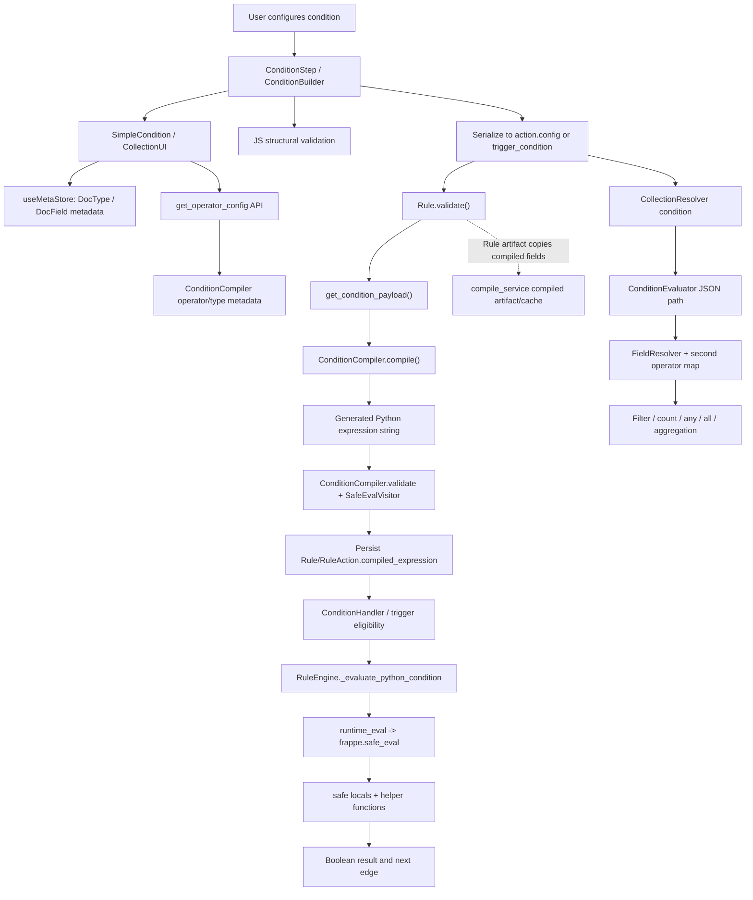

# FlexiRule Condition Comparison System — Architectural Audit

**Audit date:** 2026-10-17  
**Repository:** [Sendipad/flexirule](https://github.com/Sendipad/flexirule)  
**Audited ref:** `develop`, source snapshot `65c7372be0fe80261609fc122d153c3bb41d5199`  
**Report status:** Read-only source audit; remediation proposed, not implemented  
**Scope boundary:** This change adds this report only. No application source, tests, runtime configuration, schema, or workflow files were modified.

## 1. Executive summary

### Decision

**Recommendation: partially redesign the condition comparison core, while retaining FlexiRule-owned business semantics and Frappe's safe execution boundary.** Do not replace in-memory evaluation with database filters. Do not merge assignment operators into comparison operators. Avoid a large plug-in registry: the core needs a small, explicit domain model and a canonical set of comparison semantics, not another extensibility framework.

The current system has useful foundations: the condition builder uses Frappe DocType metadata; normal rule conditions are compiled when the Rule is validated/saved; execution uses Frappe's restricted `safe_eval`; nested groups and collection predicates are represented declaratively; and the project has existing field resolution and value-resolution facilities. Compilation reduces repeated recursive dispatch at runtime, and Frappe's safe evaluator is materially safer than raw unrestricted Python `eval`. These are not abstractions to delete simply to reduce line count.

However, the implementation is **not yet production-ready as a condition-comparison contract**. The most important findings are:

1. **Verified correctness defects:** visible operators can compile to the wrong operation, unsupported operators silently default to equality, and malformed condition nodes can compile to an unconditional pass.
2. **Verified duplicate semantics:** normal Condition actions use generated Python expressions, while collection resolver predicates use a separate JSON evaluator. The two paths support different operators, values, and error behavior.
3. **Probable security-hardening issue:** compiler-generated Python source interpolates saved field-reference strings without correct quoting/identifier validation. The AST check in FlexiRule does not itself restrict expressions to the intended condition language. Frappe's sandbox restricts Python capabilities, but it does not repair the generated condition's business meaning or prevent every unexpected call on an exposed public safe-context object. This finding is based on source construction, not a demonstrated exploit.
4. **Verified frontend/backend contract gap:** frontend defaults duplicate and differ from backend metadata; frontend validation is structural, while backend validation does not validate the entire condition tree against an authoritative operator/type contract. Field/operator changes may retain incompatible values.
5. **Semantic ambiguity:** null and empty-string values, falsy values, type conversion, Link tuples, dates/times, collection edges, and error-to-false behavior are not consistently specified across execution paths.
6. **Compatibility evidence gap:** package metadata requires Python `>=3.10`; CI currently exercises Python 3.10 and the Frappe 15 source branch. README claims Frappe v15+, but this audit did not verify a full Frappe 16 condition-comparison test suite. The latest observed CI run succeeded on the audited `develop` SHA, while its separate Frappe 16 nested-set job was skipped.

These are confirmed by inspecting current source. No test command was run as part of this report. CI results described below are observations of GitHub Actions, not an assertion that this audit independently executed the tests.

### Smallest maintainable target

Use a **small FlexiRule-owned condition domain model** with:

- A strict canonical condition schema and explicit operator identifiers.
- One authoritative backend definition of each operator's semantics, supported operand shape, and field-type applicability.
- One operand normalization/resolution path using existing FlexiRule value and field-resolution facilities.
- One in-memory comparison primitive shared by ordinary conditions and collection resolver predicates.
- Frappe DocType metadata to determine field types/options and validate references; select Frappe conversion utilities only where their actual behavior matches the rule contract.
- A compiled, validated condition plan for normal execution, rather than generated Python source for the condition tree itself. Keep separately authored formula/expression features behind their existing dedicated resolver/safe-expression boundary; do not accidentally turn arbitrary field references into source code.
- Thin frontend adapters that consume backend-provided operator metadata, with only basic UX validation duplicated client-side.

Compilation should remain as a meaningful **normalization/plan-building step** unless measurement shows it is unnecessary. The current source-string compiler should not be retained unchanged merely because the compiled field exists; it should be hardened or replaced by a structured plan. The legacy JSON evaluator should delegate to the same comparison primitive during the transition, then its duplicate operator dispatch can be removed once behavior is proven equivalent.

### Release disposition

| Priority | Recommendation | Release position |
|---|---|---|
| **P0** | Reject malformed condition schemas and unknown operators; remove silent “unknown means equality / empty means True” behavior; validate and safely encode references/aliases before execution | Required before enabling business-critical rules in production |
| **P0** | Audit expression-generation and safe-context boundaries with adversarial tests, particularly source-string interpolation and public read APIs | Required before production; exploitability is not claimed proven |
| **P1** | Define canonical operator, value, null/empty, type-conversion, collection, and failure semantics | Required before production |
| **P1** | Make compiler/runtime and collection-predicate behavior agree; add differential tests | Required before production |
| **P1** | Validate conditions server-side using schema plus Frappe metadata; make invalid persisted rules fail closed with diagnostics | Required before production |
| **P2** | Remove duplicated frontend defaults and payload-shape logic; fix stale value and Dynamic Link editing behavior | Strongly recommended before public release |
| **P2/P3** | Measure compiler and artifact-cache benefits, then remove only proven redundant layers | After correctness/security is stabilized |

## 2. Scope, evidence method, and compatibility assumptions

### Files inspected directly

The audit examined the current implementation, not earlier architectural reports. The main sources were:

- Backend condition compilation and operator metadata: [`compiler.py`](https://github.com/Sendipad/flexirule/blob/develop/flexirule/ruleflow/core/compiler.py), including the operator map/type metadata, `compile`, group/leaf/collection compilation, operand encoding, reference generation, and validation.
- Alternate evaluator and Link comparison helper: [`evaluator.py`](https://github.com/Sendipad/flexirule/blob/develop/flexirule/ruleflow/core/evaluator.py).
- Save-time lifecycle: [`rule.py`](https://github.com/Sendipad/flexirule/blob/develop/flexirule/ruleflow/doctype/rule/rule.py#L1283-L1347), especially `compile_conditions`.
- Backend condition payload contract: [`condition_payload.py`](https://github.com/Sendipad/flexirule/blob/develop/flexirule/ruleflow/core/condition_payload.py).
- Rule validation: [`validation_service.py`](https://github.com/Sendipad/flexirule/blob/develop/flexirule/ruleflow/core/validation_service.py#L46-L90) and its Condition branch near lines 509–512.
- Runtime action dispatch: [ConditionHandler](https://github.com/Sendipad/flexirule/blob/develop/flexirule/ruleflow/core/action_handlers/condition.py), [`engine.py`](https://github.com/Sendipad/flexirule/blob/develop/flexirule/ruleflow/core/engine.py#L755-L868), and [`runtime_eval.py`](https://github.com/Sendipad/flexirule/blob/develop/flexirule/ruleflow/core/runtime_eval.py#L48-L96).
- Restricted evaluation and safe context: [`permissions.py`](https://github.com/Sendipad/flexirule/blob/develop/flexirule/ruleflow/core/permissions.py#L247-L290), [`SafeFrappeAPI`](https://github.com/Sendipad/flexirule/blob/develop/flexirule/ruleflow/core/engine.py), and the Frappe v15/v16 `safe_exec.py` implementations.
- Field resolution and collection resolver predicate execution: [`field_resolver.py`](https://github.com/Sendipad/flexirule/blob/develop/flexirule/ruleflow/utils/field_resolver.py#L15-L189) and [`value_resolver.py`](https://github.com/Sendipad/flexirule/blob/develop/flexirule/ruleflow/core/value_resolver.py#L467-L590).
- Frontend: [ConditionBuilder.vue](https://github.com/Sendipad/flexirule/blob/develop/flexirule/public/js/flexirule/rule_builder/components/condition_builder/ConditionBuilder.vue), [SimpleCondition.vue](https://github.com/Sendipad/flexirule/blob/develop/flexirule/public/js/flexirule/rule_builder/components/condition_builder/SimpleCondition.vue#L68-L187), [condition_validator.js](https://github.com/Sendipad/flexirule/blob/develop/flexirule/public/js/flexirule/rule_builder/components/condition_builder/condition_validator.js), [ConditionStep.vue](https://github.com/Sendipad/flexirule/blob/develop/flexirule/public/js/flexirule/rule_builder/components/rule_config/types/ConditionStep.vue), [JS condition payload utility](https://github.com/Sendipad/flexirule/blob/develop/flexirule/public/js/flexirule/rule_builder/utils/condition_payload.js), and [useMetaStore.js](https://github.com/Sendipad/flexirule/blob/develop/flexirule/public/js/flexirule/rule_builder/stores/useMetaStore.js).
- Tests inspected: [`test_compiler.py`](https://github.com/Sendipad/flexirule/blob/develop/flexirule/ruleflow/tests/test_compiler.py), [`test_evaluator.py`](https://github.com/Sendipad/flexirule/blob/develop/flexirule/ruleflow/tests/test_evaluator.py), [`test_link_semantics.py`](https://github.com/Sendipad/flexirule/blob/develop/flexirule/ruleflow/tests/test_link_semantics.py), and `test_audit_reproductions.py`.
- Assignment's [`operators.py`](https://github.com/Sendipad/flexirule/blob/develop/flexirule/ruleflow/core/operators.py) was checked to distinguish its assignment-operation registry from comparison operators.

### Supported environment evidence

| Source | Observed evidence | Audit implication |
|---|---|---|
| `pyproject.toml` | Python `>=3.10`, Ruff target Python 3.10; Frappe dependency is bench-managed | Use Python 3.10 as the minimum baseline; Frappe version is not pinned as a standalone package dependency here |
| `.github/workflows/ci.yml` | Checkout of `frappe/frappe` ref `version-15`, Python 3.10, Node 18; server job labelled “Frappe 15” | Frappe 15 is the verified CI target; this is not a v15/v16 condition-evaluator matrix |
| README / product positioning | Describes the application as Frappe v15+ | Treat v16 as a claimed support target that needs explicit verification, not as proven by v15 CI |
| Frappe v15 source | `frappe.safe_eval` normalizes source, validates syntax, uses restricted compilation and restricted globals/attribute access | Good execution boundary, but not a substitute for a condition-language schema or operator allowlist |
| Frappe v16 source | `frappe.safe_eval` still exists, but source compiles through a different helper path; guard behavior is similar at the inspected entry points | Do not depend on undocumented internals; run behavior-level tests against both branches if both are supported |

The latest observed [CI run](https://github.com/Sendipad/flexirule/actions/runs/38956561512) on SHA `65c7372be0fe80261609fc122d153c3bb41d5199` completed successfully. The Frontend and Server (Frappe 15) jobs succeeded; the separate “Nested-set integration (Frappe 16)” job was skipped. This result does not test every condition scenario in this report and does not constitute v16 condition-engine verification.

## 3. Current architecture

### Lifecycle table

| Stage | Implementation and data form | Current behavior / concern |
|---|---|---|
| 1. Configure DocType, field, operator, value | ConditionStep.vue → ConditionBuilder.vue → SimpleCondition.vue | Operands use a reference such as `doc.status`; values can be static, Link tuples, variables, or structured FlexValue payloads. The visible UI is not itself a server trust boundary. |
| 2. Discover field metadata/operators | useMetaStore.js; ConditionBuilder loads `get_operator_config` from api.py; values draw from Frappe DocField metadata | Field metadata reuse is sensible. Backend operator metadata is authored in ConditionCompiler, but the frontend also has defaults and operator labels. |
| 3. Frontend validation/transform | condition_validator.js; SimpleCondition.vue's wrapped value and watcher logic | Validates presence/shape, not authoritative operator/type compatibility, type coercion, parser safety, or runtime support. Special Link values are transformed to/from tuples. |
| 4. Serialize | ConditionStep.vue `save`/`dehydrate`; JS condition_payload.js | Ephemeral UI IDs are removed. Conditions are stored as a direct JSON condition tree in action config or as trigger_condition. JS payload recognition is not identical to Python payload recognition. |
| 5. Backend validation | Rule.validate → validation_service.validate_rule_definition | The Condition branch checks that a payload or compiled expression exists, but does not fully validate each node/operator/operand against an authoritative schema. |
| 6. Compile | rule.py `compile_conditions` → condition_payload.py → ConditionCompiler | Normalizes a tree into a Python expression string and calls `ConditionCompiler.validate`. Malformed but parseable config can reach fallback compilation. |
| 7. Resolve operands | Compiler-generated `doc.get`, `vars.get`, or `resolve(scope, path)`; engine safe locals include FieldResolver.resolve | Runtime values are resolved during execution. The compiler also rewrites literal booleans/null-like values and has special handling for structured operands. |
| 8. Compare | Generated Python operators/helper calls, or evaluator.py's `OPERATORS` map | There are two independent dispatch paths with different operation sets and error behavior. Unknown compiler operators default to equality. |
| 9. Propagate logic | Compiled Python `and`/`or` and generator `any/all`; alternate evaluator traverses groups/collections recursively | Nested logic is useful, but empty/malformed structures do not consistently fail closed. |
| 10. Return result/diagnostics | ConditionHandler selects next action; runtime_eval logs errors and returns default False except NameError is re-raised | Ordinary comparison failures can be converted to False, potentially making an invalid rule look like an ordinary branch decision. Collection evaluator also logs errors and returns False. |

### Where meaning can change

1. **Operator name:** frontend labels like/not like as contains/not contains, compiler map omits those operator tokens, and the alternate evaluator does not handle them.
2. **Malformed node:** a dict without a recognized node shape can become an empty compile result, then the root compiler returns `True`.
3. **Value representation:** null becomes an empty string in the compiler; the JSON evaluator can preserve Python `None`. Structured FlexValue values are handled by the compiler, but not equivalently by ConditionEvaluator.
4. **Link value:** the UI may wrap a static Link RHS as `[DocType, value]`; the comparison helper uses the scalar value and does not verify the DocType element.
5. **Type:** the field metadata can suggest a numeric/date field, but the comparison engine does not apply a consistent Frappe fieldtype conversion before Python comparison.
6. **Runtime path:** a normal Condition action uses the compiled expression; CollectionResolver predicates use ConditionEvaluator.
7. **Failure policy:** compiler output for unknown operation becomes equality; evaluator unknown operation/error becomes False; an empty root compile can become True.
8. **Context and path:** frontend sanitizes its displayed loop alias but the compiler consumes the raw saved alias; reference paths are inserted into generated source strings.
9. **Empty semantics:** is_set/is_not_set consider None and empty string; is_empty uses another helper, where whitespace-only strings are empty; zero and False are not empty. These can be sensible choices but need to be canonical, tested, and documented.

## 4. Operator inventory and semantic matrix

This inventory records the implementation found, rather than implying every token is intentionally supported in every context.

| Operator or family | Source of semantics today | Type/UI exposure | Principal gap / recommendation |
|---|---|---|---|
| `==`, `!=` | Compiler emits Python equality/inequality; ConditionEvaluator uses `operator.eq/ne` | Offered for most field types; Check limits UI to equality/inequality | No consistent typed coercion. Decide whether comparison is typed by left DocField or strict runtime type, then implement once. |
| `>`, `<`, `>=`, `<=` | Python native operators in compiled expression; evaluator uses operator functions | Numeric, date/time, duration, rating lists | Numeric strings, Decimal/float, date/date-time, aware/naive values are not normalized consistently. Mismatches may become False rather than a clear configuration error. |
| `in`, `not in` | Compiler maps `in` and spaced `not in`; evaluator uses `in` and accepts `not_in` via normalization | UI membership controls | Compiler's fallback for `not_in` produces equality; empty-container behavior differs from native Python because evaluator explicitly returns false/true for empty RHS. Specify supported RHS types and empty-list behavior. |
| `like`, `not like` | UI metadata only labels them “contains” / “not contains”; not correctly mapped in compiler | Offered for Data/text fieldtypes | **Verified defect:** compiler defaults both to equality. Either implement documented contains semantics or reject them; do not silently reinterpret. |
| `contains`, `not_contains` | Custom source generation and parallel lambdas in evaluator | Compiler supports source generation; central fieldtype lists generally offer like/not like instead | Converts LHS to string, does not normalize RHS, uses LHS truthiness. Keep only one canonical name/implementation and define non-string behavior. |
| `is_set`, `is_not_set` | Custom predicates in compiler and evaluator | Offered for many scalar/special fields | None and empty string count as unset; whitespace does not. This differs from `is_empty`. Define intended semantics separately and test. |
| `is_empty`, `is_not_empty` | Compiler helper `is_empty_value`; engine helper at engine.py around lines 813–820 | Offered for default and table fields; hidden RHS in UI | ConditionEvaluator doesn't implement them. Engine semantics treat None, whitespace-only strings, and empty containers as empty; 0 and False are not empty. |
| `length_eq/gt/gte/lt/lte` | Compiler generates `length_of(lhs)` | Table/Table MultiSelect lists; frontend changes RHS schema to Int | ConditionEvaluator does not implement them. For strings, helper strips whitespace before counting; this is a business choice that needs to be made explicit. |
| `regex` | ConditionEvaluator only: `re.search(pattern, str(value))` | Not in compiler's operator map or the central visible fieldtype lists | Different execution availability; potentially expensive patterns on long input have no standard-library timeout. Decide whether to support, constrain, or deprecate. |
| `is_submittable`, `has_field` | Compiler-generated helper calls backed by engine metadata helpers | Labels exist, but not in the visible `FIELDTYPE_OPERATORS` map or its normal field lists | Compiler-only paths must be explicitly represented in validation and UI metadata. Validate argument shape and reject wrong contexts. |
| `has_changed` | Compiler emits literal `True` and warns at compile time | Legacy compatibility path; not in central visible operator list | This is not a real comparison. It can silently make an old saved condition pass. Require migration/deprecation policy and refuse activation for this operator unless its semantics are restored. |
| `is`, `is not` | In `OPERATOR_MAP`; emitted as Python identity comparison | Not part of central fieldtype operator mapping | Identity is rarely the business intent for serialized field values. Prefer explicit null/set operators or value equality. Do not expose without defined use cases. |
| Link/Dynamic Link tuple | Compiler special case calls `check_link_match`; evaluator has similar helper | UI turns a static Link value into a two-element tuple | Helper explicitly treats DocType as informational and compares only the value, so the wrong DocType can match a same-named record. Decide whether DocType identity is part of the contract; use the selected field's metadata for validation. |
| Check/boolean values | UI limits operators to equality/inequality; compiler maps literal True/False to 1/0 | Frappe Check fields | Server does not enforce RHS is an allowed boolean representation. Clarify accepted inputs (True/False, 1/0, strings) rather than relying on Python equality. |
| Date/Datetime/Time/Duration | Native Python comparison once operands resolve | Operators exposed by fieldtype lists | No central temporal conversion/time-zone policy. Invalid mixed-type values may throw and become false. Define date/time parsing and aware/naive policy. |
| Collection Any/All/None | Compiler generates Python `any/all` generator expression; ConditionEvaluator recursively walks lists | CollectionUI exposes any/all/none | Compiler and evaluator differ for non-list iterables, invalid/empty where clauses, aliases and error behavior. One collection plan should call the same predicate comparator. |
| Nested AND/OR | Compiler emits Python logical expressions; evaluator walks recursively | Root/group toggles in frontend | No explicit negation node. Sequential join behavior must be specified and tested. Empty groups currently tend to pass regardless of AND/OR intent. |
| Unknown operator | Compiler: `OPERATOR_MAP.get(op, "==")`; evaluator logs and returns False | Frontend values are not guaranteed to be validated by server | **Verified unsafe fallback:** reject unsupported tokens with a path-specific validation error. Never substitute equality or a success result. |

### Canonical operator design

A canonical operator definition does not need to be a general-purpose registry framework. A small immutable definition table or explicit mapping can carry:

- Canonical token and label/translation key.
- Whether the RHS is required and its expected operand shape.
- Supported fieldtype families and any required metadata/options.
- Pure comparison function or operation enum.
- Null/empty and type-conversion policy identifiers.
- Optional aliases for existing saved payloads, with explicit deprecation warnings.

The compiler, server validator, collection resolver and frontend DTO should use the same definitions where practicable. Keep frontend-only display grouping/order separate from comparator semantics. Avoid having labels define behavior, and avoid asking the frontend to be the security validator.

## 5. Reuse opportunities: Python, Frappe, and existing FlexiRule code

### Frappe metadata and field handling — reuse

Frappe's public `frappe.get_meta(doctype)` and DocField metadata provide fieldtype, options, Link target DocType, child-table target DocType, and other field properties. FlexiRule already reuses this through the metadata store in `useMetaStore.js` and through backend helpers. Extend this capability to server-side condition validation; do not invent a second DocField catalogue.

This satisfies field discovery and type/relationship validation. It does **not** define FlexiRule's comparison semantics, value resolver language, or nested collection operators. The authoritative server must still resolve and validate field paths (including aliases and child-table scope) from metadata.

### Frappe's in-memory filter comparator — reuse selectively

Frappe v15's `frappe.utils.data.compare(val1, condition, val2, fieldtype=None)` is an existing in-memory helper used by `evaluate_filters`. The source around [Frappe v15 data.py](https://github.com/frappe/frappe/blob/version-15/frappe/utils/data.py#L1874-L1935) shows operator dispatch and fieldtype-aware casting, including special branches for `is`, `in/not in`, `between`, and Datetime bounds. This is direct evidence that FlexiRule need not invent every numeric/date conversion primitive.

Best option: **evaluate and selectively adapt/reuse the conversion behavior**, with tests for the exact public interface in both target versions. It can reduce custom casting for ordinary field-value comparisons. It does not automatically satisfy FlexiRule's full requirements: structured Link operands, flexible resolver values, child collection predicates, business-specific empty semantics, regex policy, helper operators, and condition-specific diagnostics. Its database-filter-style operator spellings and casting behavior should not silently become FlexiRule's public contract.

### Frappe filter/query facilities — do not replace in-memory evaluation

`frappe.get_list`, `frappe.get_all`, `frappe.qb`, and `frappe.get_query` serve data retrieval/filtering, not a universal in-memory business-condition DSL. Query filters can be useful inside Query Records/Fetch Records, but aren't interchangeable with an evaluator for an already-loaded document or child row.

Differences include SQL NULL behavior, database collation and case sensitivity, LIKE wildcard matching, data coercion, query permission policy, and whether a filter executes against a current in-memory value versus a database snapshot. In particular, `get_list` is permission-aware while `get_all` bypasses permissions. Do not move normal conditions to SQL merely to reuse database filter operators.

### Python standard library — reuse for elementary operators and types

- Python's `operator` module already supports basic comparison functions and is used by ConditionEvaluator. Keep basic equality/order dispatch simple.
- `datetime.date`, `datetime.datetime`, `datetime.time`, and `decimal.Decimal` are adequate primitives, provided FlexiRule defines parsing and type normalization before comparison.
- Python's `re` is available but does not provide a general per-match execution timeout in its standard API. A size limit alone does not prevent every pathological regular expression. Either limit the regex feature and inputs, adopt a safe/limited pattern implementation if needed, or remove it from rule conditions.
- Python collections and type-checking are sufficient; no additional expression-engine dependency has been demonstrated as necessary.

### Frappe safe evaluation — retain as boundary, not as the domain engine

Source inspection of Frappe v15's `frappe/utils/safe_exec.py` shows that `safe_eval` validates syntax, removes builtins, uses restricted compilation and guarded attribute access. Frappe v16 has the corresponding public entry point, with a different internal compile helper in the inspected source. FlexiRule's `runtime_eval.py` correctly uses `frappe.safe_eval` rather than direct unrestricted `eval`.

However, safe evaluation does not define a canonical operator vocabulary or ensure a generated expression accurately represents a selected UI operation. Nor should FlexiRule rely on private RestrictedPython transformation details as its validation contract. Prefer the public API and a narrow FlexiRule AST/plan schema. Keep arbitrary resolver/formula features explicitly separate from ordinary point-and-click conditions.

### Existing FlexiRule primitives — reuse where semantics agree

| Existing implementation | Useful capability | Limitation / recommended boundary |
|---|---|---|
| `FieldResolver.resolve` | Document, child-table path, parent reference, and aggregate resolution | Parent resolution can fetch a document; aggregate numeric filtering currently accepts int/float but not Decimal/numeric strings. Validate paths before resolving. |
| `ValueResolver` / `CollectionResolver` | Existing value resolution, collection iteration, operation set and a 10,000-row execution bound | CollectionResolver currently embeds ConditionEvaluator for filtering. Keep row bounds, but share the same operator semantics and structured value normalization. |
| `ConditionEvaluator` | Reusable JSON traversal and row predicate path | Its comparison table differs from ConditionCompiler and it turns many invalid runtime comparisons into False. Use it as a migration adapter or refactor its traversal, not as a second comparator. |
| `ConditionCompiler` | Save-time compilation and Frappe operator metadata endpoint | Current generated source and metadata responsibilities are entangled; unknown tokens default to equality; reference source escaping is fragile. Retain the compile/plan concept, not necessarily source-code generation. |
| `SafeFrappeAPI` | Intentional read-only facade and restricted data helpers | Includes `get_all`/database `get_all` paths that bypass record permissions. The security policy for condition expressions must be explicit; don't assume restricted Python means permission-filtered data. |
| `operators.py` AssignmentOperatorRegistry | Metadata-driven assignment operations (set, clear, increment, append, etc.) | Assignment mutates targets and has different validation/idempotence semantics. Do not merge it with comparison definitions just because both use operator terminology. |
| Frappe `get_meta` and frontend meta store | Central DocField types/options and cached metadata | Strong reuse candidate for field-type checks and picker values; not a replacement for server validation or semantic comparison. |

### Complexity assessment

Most avoidable complexity is not the number of classes. It is the cost of maintaining **two comparator implementations plus overlapping metadata and normalization contracts**. The highest-value reduction is:

1. One strict condition schema.
2. One typed operand resolution/normalization path.
3. One comparison dispatch table for all operators.
4. Thin compile/evaluate adapters for ordinary rule actions and collection predicates.
5. One payload shape/alias normalization contract shared by frontend and backend where code sharing is practical.

This reduces duplicated semantic branches and enables differential testing without requiring a universal plugin registry.

## 6. Compiler and intermediate representation

### What compilation currently provides

`ConditionCompiler.compile` transforms a JSON tree into a Python expression string. `Rule.validate` calls `compile_conditions`, which compiles trigger conditions and Condition-action payloads and persists `compiled_expression`. Runtime then evaluates the saved expression through `frappe.safe_eval`. In the ordinary path this avoids rewalking the full JSON node tree for every invocation; that is a real architectural benefit.

The current compiler also:
- Wraps list-shaped legacy conditions in an AND group and accepts double-encoded JSON.
- Emits helper calls for child paths, collection checks, length and metadata operators.
- Converts structured FlexValue inputs (static, variable, resolver/formula, expression) into Python expressions.
- Validates generated expression syntax and invokes FlexiRule's AST safety visitor.

### Costs and problems

The compiler is also the owner of UI operator labels and fieldtype mappings, while it has no complete backend condition schema validator. It writes source code using user-configured condition references and some raw aliases. Its fallback paths can hide unsupported shapes. Dynamic resolver/expression payloads can insert source expressions, which means the safe-expression grammar is coupled to compilation details.

This setup is harder to reason about than a plan containing explicit operations and operands. The compiler and evaluator also do not normalize values identically. Tests that assert exact string output can pass while the intended business operation is not performed: a generated `==` expression can be perfectly syntactically valid and safe to evaluate, yet still be a semantic defect.

### Compilation recommendation

**Retain compilation as a transformation, but move toward a validated, structured plan.**

An internal plan should contain a node kind, explicit AND/OR join, validated field/context reference, canonical operator enum, normalized operand definition, and nested collection plan. Cache the normalized plan by a version/hash if profiling supports it. Evaluate this plan with the canonical comparator. The plan should not be executable Python text assembled from saved strings.

If a migration requires retaining current expressions temporarily, immediately enforce strict schema/operator validation, quote path components safely, constrain aliases to valid identifiers, validate generated ASTs against a narrow allowlist for *compiler-generated conditions*, and run the same comparator behavior tests against legacy ConditionEvaluator. Do not use the same AST allowlist indiscriminately for formula features that intentionally support richer expression syntax.

### Compiled artifact cache

`compile_service.py` builds a rule-level artifact and caches it under a v1 Redis prefix. For Condition actions, it copies `action.compiled_expression`; it does not itself create a second condition expression. Search found a direct use in a Rule test but no production call sites for `get_compiled_artifact` / `cache_compiled_artifact` beyond the service module in the available code search. Treat production usefulness as **unverified/probable redundancy**, not a confirmed runtime duplication. Before removing it, perform a complete call-site audit and measure consumers, invalidation guarantees, and expected rule-plan usage. Its 24-hour cache should also have an explicit version/hash invalidation story if production consumers exist.

## 7. Runtime semantics, correctness, and security

### Values and comparisons

Python's native operators are suitable primitives, but not a fully specified business contract. The current code can compare strings lexicographically, compare int and float according to Python rules, raise on incompatible types, and treat `None` according to the exact operand emitted by the compiler. The project must define expected behavior based on field metadata and operand form rather than accidentally inherit Python behavior in every case.

Examples that need explicit answers:
- Does a Currency comparison convert both values to Decimal, and what rounding/scale applies?
- Should numeric string `"10"` equal integer `10`, or should the value fail validation?
- Does Date compare to Datetime, and if so, which day boundary and timezone apply?
- Are timezone-aware and naive datetimes compatible?
- Does null differ from empty string for all field types?
- Are booleans valid as numeric values?
- Does `not in []` return True, raise validation, or mean something else?
- Does string contains treat a missing/falsy LHS as false for contains and true for not-contains?
- Are lists only values for membership, or may tuples/strings/sets also be supplied?

A fieldtype-aware converter should be deterministic and strict. It should not blanket-cast all values with `flt` or `cint`, which can corrupt precision or erase the distinction between literal text and numeric values.

### Errors and fail-closed behavior

There are at least three different failure policies today:
- Compile-time: unknown operators fall back to equality; unrecognized root nodes can result in an expression that passes.
- Compiled runtime: evaluation exceptions other than NameError are logged and return false.
- JSON evaluator runtime: unsupported operators and exceptions are logged/converted to false.

Returning false for an actual value comparison error may be acceptable only when the contract explicitly says evaluation failure counts as a non-match. It must not be used to conceal unsupported operators, invalid syntax, stale compilation, or invalid metadata. Those are configuration errors and should be rejected before activation and reported distinctly at runtime for old stored rules.

### Reference construction and the safe boundary

The compiler's `_resolve_ref` builds calls such as `doc.get('field')` and `resolve(doc, 'nested.path')` using string interpolation of the path components. The FlexiRule `validate_safe_eval` visitor rejects dunder identifiers/attributes and import nodes, but it does not define an allowlist of condition AST node types and allowed calls. The runtime local context contains `frappe` bound to `SafeFrappeAPI` by default; that facade exposes public read methods including `get_all` and `db.get_all`, which bypass user record permissions under Frappe conventions.

This is **not a claim that arbitrary OS code execution is possible**: Frappe's `safe_eval` applies its own restrictions. The concern is narrower but important: a condition reference is expected to name a field, yet unescaped source text can alter the resulting expression structure and potentially invoke public methods in the expression's available safe context. Depending on the rule-author trust model, that can produce unexpected reads/branch outcomes and breaks the intended “reference, not expression” contract.

Recommended controls:
1. Parse and validate reference paths as structured paths: allowed root scope, nonempty path segments, known field/alias where applicable, no quotes or expression syntax.
2. Do not concatenate raw path fragments inside Python string literals; use safe literal encoding even if source generation remains temporarily.
3. Prefer a plan and call a field resolver with validated path data rather than emitting source.
4. Separate formula/resolver syntax from standard condition paths. Their source or payload should be validated according to a deliberately defined grammar.
5. Make safe-context data access policy explicit: use permission-aware reads where rule conditions are expected to reflect the current user's visible data; allow permission-bypassing reads only under a documented privileged-rule policy with auditable behavior.
6. Add negative security tests against both Frappe 15 and 16 before changing the boundary.

### Regular expressions and resource limits

The `regex` operator is implemented in ConditionEvaluator via `re.search` and does not share the compiled-condition operator model. There is no timeout in that code path. A pathological pattern applied to a long string can consume excessive CPU. Regex appears to be a legacy/collection predicate capability, and exposure beyond trusted rule authors is unverified. Decide whether this is a supported product feature; if retained, bound inputs/patterns, test expensive-pattern cases without allowing indefinite CI hangs, and consider a safe pattern engine if requirements warrant it.

The collection resolver's 10,000-row cap is a justified protective bound. Retain a similar explicit cost policy for nested collections and any custom operation that can traverse large child lists or repeatedly fetch parent documents.

## 8. Frontend architecture and contract audit

### Positive reuse

- The frontend is built with Vue 3 components and composables; the builder keeps editable state local and emits model changes.
- DocType fields are sourced through the existing meta store and Frappe metadata.
- Link search uses Frappe's `frappe.desk.search.search_link` API rather than maintaining a separate global list of Link records.
- ConditionStep adds ephemeral IDs for Vue identity and removes them before persistence. Those IDs do not appear intended as domain identifiers, which is appropriate.

### Gaps

**Operator defaults:** SimpleCondition.vue contains its own `DEFAULT_OPERATORS` and `DEFAULT_LABELS`. These differ from `ConditionCompiler.FIELDTYPE_OPERATORS`: the local default mapping offers ordered comparisons for generic fields and `contains`, while the backend `_default` list is equality/set/empty. If metadata fetching fails or an unrecognized field type is encountered, the frontend can offer a token that the backend does not support. The fallback keeps the screen usable during a network error, but it undermines parity and can misrepresent save-time behavior.

**Frontend validation:** condition_validator.js checks groups, collections, selected field/operator and whether a RHS exists. It does not prove that the operator is allowed for the field type or accepted by the compiler; it does not validate the resolved right-hand type or security-sensitive reference paths. This is reasonable as immediate UX validation but insufficient as the domain validation layer.

**State after field/operator changes:** SimpleCondition.vue watches fieldtype and operator mainly to ensure a RHS object/default exists. It does not centrally re-normalize or reject an existing value that is incompatible with the newly chosen field/operator. Membership operators adapt the control to a multi-select type, and switching operators can leave a value originally selected for another shape.

**Dynamic Link round-trip:** dynamic link DocType is kept in component-local `dynamicLinkDocType` state. The getter unwraps static Link tuple values from saved RHS data, but the displayed Dynamic Link picker is not clearly hydrated from the saved tuple's DocType element. A saved condition can therefore reopen with the read-only “Select DocType first” state until the user picks the linked DocType again. This is a likely edit-round-trip inconsistency; confirm with a frontend reproduction.

**Payload shape:** JS `isConditionPayloadShape` requires the expected shape of a group, leaf or collection; Python `parse_condition_payload` accepts any JSON Mapping/list, and its config extraction checks the presence of broad keys. Rule.compile_conditions then falls back to raw nonempty config when extraction fails. This can cause UI-open/edit behavior and backend compile behavior to diverge.

**UI/runtime capabilities:** `has_field`, `is_submittable`, `regex`, `has_changed` and some empty/length operators are not consistently available in the central frontend list, compiler and alternate evaluator. An operator's existence in a label table is not a proof of valid configuration or execution.

### Frontend recommendation

Do not replace the current control system or introduce another dependency. Keep the current controls and Frappe metadata API. Remove the duplicate fallback operator inventory after the backend contract becomes reliable. The frontend may still do fast basic validation, but it should consume the same canonical operator descriptors and clearly indicate when metadata loading failed rather than showing a knowingly divergent set. On save, the backend must validate every field, operator, operand and tree shape.

## 9. Findings register

Severity uses the requested scale. **Verified** means directly established by current code structure or behavior; **probable** denotes a likely user-visible/security consequence that should be reproduced in focused tests; **unverified** means a full call-site/runtime proof is unavailable. No item below is a claim that its proposed fix has already been applied.

### CC-001 — “like” and “not like” compile to equality

- **Severity:** High; **Category:** correctness / frontend-backend consistency; **Status:** Verified; **Confidence:** High.
- **Evidence:** [`compiler.py`, operator metadata and leaf compilation](https://github.com/Sendipad/flexirule/blob/develop/flexirule/ruleflow/core/compiler.py#L39-L129) and [`_compile_condition`](https://github.com/Sendipad/flexirule/blob/develop/flexirule/ruleflow/core/compiler.py#L218-L290). The central Data/text operator lists contain `like` and `not like`; the labels describe them as contains/not-contains, but `OPERATOR_MAP` does not map either. Unknown operators use `"=="`.
- **Reproducible example:** LHS `"urgent invoice"`, RHS `"urgent"`, op `like`. The expected contains-style predicate is true; the current compiler emits an equality expression and evaluates false. `not like` likewise becomes inequality rather than the complement of contains. The alternate evaluator's map also does not implement these tokens.
- **Impact:** User configures the displayed operation, but execution performs another operation. Rule branches may be taken incorrectly with no compile error.
- **Recommendation:** Define the exact semantics for “like” (literal substring vs SQL wildcard pattern), map it explicitly, or remove/reject the token and require canonical `contains` / `not_contains`. Provide legacy alias normalization only if its semantics are explicit.
- **Existing implementation considered:** Python substring/regular operators and Frappe `compare` with LIKE-style semantics exist, but they are not interchangeable without a documented wildcard/case policy.
- **Remediation:** P0; bug fix and possible backward-compatibility change; Medium effort / Medium regression risk.

### CC-002 — Unknown operator and malformed condition can pass instead of fail

- **Severity:** High; **Category:** correctness / security; **Status:** Verified; **Confidence:** High.
- **Evidence:** [`compiler.py`](https://github.com/Sendipad/flexirule/blob/develop/flexirule/ruleflow/core/compiler.py#L131-L180) returns `"True"` when a root dict is not a recognized node; [`_compile_condition`](https://github.com/Sendipad/flexirule/blob/develop/flexirule/ruleflow/core/compiler.py#L218-L290) uses equality as the default operator; [`rule.py`](https://github.com/Sendipad/flexirule/blob/develop/flexirule/ruleflow/doctype/rule/rule.py#L1309-L1347) falls back to raw nonempty config when payload extraction returns None; [validation_service.py](https://github.com/Sendipad/flexirule/blob/develop/flexirule/ruleflow/core/validation_service.py#L509-L512) checks presence, not the full tree schema.
- **Reproducible example:** Config `{"foo":"bar"}` is valid JSON but not a valid group/leaf/collection. Extraction can fall back to this raw config, compiler node detection returns no expression, and root compile returns `True`. A leaf with an unrecognized operator emits an equality predicate.
- **Impact:** Invalid definitions can become permissive conditions. This is especially dangerous where a condition is intended as an execution gate.
- **Recommendation:** Validate schema before compile; require exact node-kind shape, valid operator token and operand shape; raise a path-specific validation error; do not fallback unknown operator to equality or unknown root to True. Only a deliberately empty optional gate should mean pass, and only through an explicit contract.
- **Existing implementation considered:** JSON Schema is already a project dependency; a small schema validator plus domain-specific checks can reject malformed input. Frappe's general document validation does not define this condition schema for FlexiRule.
- **Remediation:** P0; bug fix and potentially backward-incompatible for malformed saved configs; Medium effort / Medium risk after inventorying legacy payloads.

### CC-003 — Field-path interpolation undermines the intended condition grammar

- **Severity:** High; **Category:** security / correctness; **Status:** Probable; **Confidence:** Medium-high.
- **Evidence:** [`_resolve_ref`](https://github.com/Sendipad/flexirule/blob/develop/flexirule/ruleflow/core/compiler.py) interpolates field components into generated Python string literals. [FlexiRule SafeEvalVisitor](https://github.com/Sendipad/flexirule/blob/develop/flexirule/ruleflow/core/permissions.py#L247-L290) rejects dunder/import constructs but does not limit the AST to a full condition-only grammar. The runtime exposes a `SafeFrappeAPI` instance in safe locals, including `get_all` / `db.get_all` methods ([engine.py](https://github.com/Sendipad/flexirule/blob/develop/flexirule/ruleflow/core/engine.py#L755-L845)). Frappe v15 and v16 safe_eval restricts Python attributes and builtins, but public methods on supplied objects remain a separate exposure policy.
- **Reproducible investigation case:** Submit a path containing a single quote and condition syntax, then inspect whether generated expression source contains an unexpected extra expression/call. This has not been executed in this audit. A crafted nested path can plausibly close the compiler-created quoted literal and alter the expression.
- **Impact:** A field-reference feature can stop behaving like a pure path. Depending on rule-author permissions and safe-context policy, this can access allowed public APIs from a path input and influence branch outcomes. This is not evidence of unrestricted Python/OS code execution.
- **Recommendation:** Strictly validate root and path segments; encode literal strings correctly; reject arbitrary expression syntax in field references; prefer an explicit plan with references as data. Separate authored formulas from field references. Review whether permission-bypassing `get_all` is appropriate in condition safe context.
- **Existing implementation considered:** Frappe safe_eval is necessary as a boundary for expression features, but does not validate FlexiRule field-path semantics. Python's string repr/AST facilities can help during an interim source-code hardening; a structured plan is a stronger solution.
- **Remediation:** P0; security hardening and architectural correction; Medium-to-high effort / High regression risk if mixed with a broad redesign. Reproduce and add negative tests before closing the finding.

### CC-004 — Two active comparison engines have different operator support

- **Severity:** High; **Category:** architecture / correctness / frontend-backend consistency; **Status:** Verified; **Confidence:** High.
- **Evidence:** Compiled conditions use [`ConditionCompiler`](https://github.com/Sendipad/flexirule/blob/develop/flexirule/ruleflow/core/compiler.py). Collection predicates create [`ConditionEvaluator`](https://github.com/Sendipad/flexirule/blob/develop/flexirule/ruleflow/core/evaluator.py), from [`CollectionResolver`](https://github.com/Sendipad/flexirule/blob/develop/flexirule/ruleflow/core/value_resolver.py#L467-L590), using a second `OPERATORS` map.
- **Concrete divergence:** ConditionEvaluator implements `regex` and `not_in`, but not `is_empty` or `length_*`; compiler supports empty/length helpers but not regex. Structured FlexValue modes are expanded by compiler code; `ConditionEvaluator._resolve_value` treats a payload without a legacy type as its raw `value`, so it does not interpret all of the same structured value modes. Error handling is also different.
- **Impact:** The same logical predicate can behave differently when used in an ordinary Condition node versus a resolver filter. Tests confined to either path won't detect this class of regression.
- **Recommendation:** Make one comparison primitive authoritative. Reuse ConditionEvaluator's tree traversal only if helpful, but delegate all leaf operation/value semantics to a shared domain module. During migration, differential tests should establish intended behavior before moving old saved definitions.
- **Existing implementation considered:** Python `operator` functions, Frappe's compare/cast helper and existing FieldResolver are useful building blocks; none makes the duplicate dispatch tables safe to keep.
- **Remediation:** P1; semantic alignment and then refactor; High effort / High regression risk unless built with differential tests and a compatibility adapter.

### CC-005 — Null, empty string and structured values are normalized differently

- **Severity:** Medium; **Category:** correctness / frontend-backend consistency; **Status:** Verified; **Confidence:** High.
- **Evidence:** [Compiler operand encoding](https://github.com/Sendipad/flexirule/blob/develop/flexirule/ruleflow/core/compiler.py) maps `None` to an empty string and booleans to `1/0`; [ConditionEvaluator operand resolution](https://github.com/Sendipad/flexirule/blob/develop/flexirule/ruleflow/core/evaluator.py) preserves raw `None` for `{"value": null}` and does not unwrap the full new structured FlexValue payload in the same way.
- **Reproducible example:** RHS `null` can mean `''` in generated compiled code and Python `None` on the JSON evaluator path. Comparing a missing/None LHS can therefore differ from a comparison against the compiled empty string.
- **Impact:** Null and intentionally empty values are collapsed in one path. UI round-trips may also turn an unset operand into a static empty value.
- **Recommendation:** Preserve the structured value shape through validation/plan compilation. Define null, empty string, False and 0 separately; normalize once based on fieldtype and explicit value mode.
- **Existing implementation considered:** Existing FlexValueControl/ValueResolver is the source of operand modes; use it rather than inventing a parallel structured-value interpreter.
- **Remediation:** P1; semantic clarification + bug fix, with backward-compatibility implications; Medium effort / Medium risk.

### CC-006 — Comparisons are mostly untyped despite fieldtype-aware UI

- **Severity:** Medium; **Category:** correctness / maintainability; **Status:** Verified; **Confidence:** High.
- **Evidence:** FIELDTYPE_OPERATORS limits available choices, but compiler emits native Python operators and ConditionEvaluator uses native operator functions without common fieldtype normalization. Several imports in evaluator (`cint`, `flt`, `getdate`) do not participate in its operator dispatch.
- **Impact:** Numeric strings, Decimal/float, date/date-time, temporal timezone mismatches and malformed operands rely on Python runtime behavior; exceptions can become false conditions.
- **Recommendation:** Choose a type policy per Frappe fieldtype: either require correctly typed values or normalize them through a single tested converter. Use Decimal where precision matters. Define aware/naive datetime handling, date-to-datetime boundaries and invalid-input diagnostics.
- **Existing implementation considered:** Frappe's public metadata and `frappe.utils.data.compare/cast` can cover some ordinary conversions; Python datetime/Decimal are sufficient primitives. Avoid indiscriminate `flt`/string casts.
- **Remediation:** P1; semantic clarification and bug fixes; Medium-high effort / Medium-high risk because legacy rules may depend on current behavior.

### CC-007 — Nested and collection edge cases are not fail-closed consistently

- **Severity:** Medium; **Category:** correctness; **Status:** Verified; **Confidence:** High.
- **Evidence:** [Compiler group and collection paths](https://github.com/Sendipad/flexirule/blob/develop/flexirule/ruleflow/core/compiler.py#L182-L320) skip some unrecognized nodes, use `True` when collection predicate compilation yields no expression, and interpolate aliases. [ConditionEvaluator](https://github.com/Sendipad/flexirule/blob/develop/flexirule/ruleflow/core/evaluator.py) returns True for empty groups and for collection nodes missing a path/where; it returns False for non-list rows. Compiled Python generator expressions can iterate other iterable types.
- **Impact:** Empty groups, incomplete collections, invalid aliases and non-list collections may produce unintended truth values or runtime outcomes.
- **Recommendation:** Define empty group truth semantics for AND and OR separately or reject empty nested groups; require a valid collection reference and nonempty predicate when required; validate aliases; specify list/tuple/iterable policy and row limits. Do not turn invalid collections into a pass predicate.
- **Existing implementation considered:** Python's any/all are suitable primitives once the collection and predicate plan are validated. Existing CollectionResolver row cap should be retained.
- **Remediation:** P1; bug fixes and semantic clarification; Medium effort / Medium risk.

### CC-008 — Regex execution lacks a resource policy

- **Severity:** Medium; **Category:** security / performance; **Status:** Verified implementation, exposure impact unverified; **Confidence:** High on missing limit, medium on user exposure.
- **Evidence:** [`ConditionEvaluator.OPERATORS`](https://github.com/Sendipad/flexirule/blob/develop/flexirule/ruleflow/core/evaluator.py) calls `re.search` directly. This operator exists on the alternate JSON path and is absent from the compiled operator inventory.
- **Impact:** Some patterns can require disproportionate CPU on long input strings; behavior also differs by execution path.
- **Recommendation:** Decide if regex is supported. If retained, constrain pattern/input behavior, document semantics, and use a safe/limited implementation if arbitrary user patterns are in scope. Ensure test cases won't hang the suite.
- **Existing implementation considered:** Standard `re` is available but offers no general timeout argument to this call. Adding a new dependency is warranted only if regex is a real product requirement.
- **Remediation:** P1 if user-authored regex is a supported feature; otherwise P2 to deprecate/remove; Medium effort / Medium risk.

### CC-009 — Frontend fallback operators, round-trip values and payload detection drift

- **Severity:** Medium; **Category:** frontend/backend consistency / maintainability; **Status:** Verified for duplicated inventories and shape logic; probable for Dynamic Link round-trip; **Confidence:** High / Medium respectively.
- **Evidence:** [SimpleCondition.vue](https://github.com/Sendipad/flexirule/blob/develop/flexirule/public/js/flexirule/rule_builder/components/condition_builder/SimpleCondition.vue#L68-L119) carries its own operator and label fallbacks. [Python payload handling](https://github.com/Sendipad/flexirule/blob/develop/flexirule/ruleflow/core/condition_payload.py#L48-L95) and [JS payload handling](https://github.com/Sendipad/flexirule/blob/develop/flexirule/public/js/flexirule/rule_builder/utils/condition_payload.js) do not recognize precisely the same shapes. SimpleCondition retains RHS state when field/operator changes. Dynamic Link DocType picker is local state and is not clearly reconstructed from the saved tuple.
- **Impact:** The builder can expose a token backend doesn't support, preserve a stale operand, or re-open an existing Dynamic Link value in an incomplete state. Shape mismatches can make a condition edit/save round-trip differ from backend interpretation.
- **Recommendation:** Have the backend return the canonical operator descriptors; use local labels/order only for display, not fallback semantics. Validate and normalize payloads on the server; apply an explicit RHS transition policy when field/operator changes; hydrate Dynamic Link DocType state from the persisted value. Verify by opening and saving representative existing rules without modifying their semantics.
- **Existing implementation considered:** Existing FlexiRule SelectControl, FlexValueControl and meta store suffice; no new design system/dependency required.
- **Remediation:** P2; bug fix/refactor, potentially compatibility-sensitive only where currently malformed payloads exist; Medium effort / Medium regression risk.

### CC-010 — Frappe v16 compatibility is not established for conditions

- **Severity:** Medium; **Category:** compatibility; **Status:** Verified CI evidence gap; **Confidence:** High.
- **Evidence:** `pyproject.toml` requires Python >=3.10; [CI workflow](https://github.com/Sendipad/flexirule/blob/develop/.github/workflows/ci.yml) checks out Frappe `version-15`, Python 3.10. The latest run's separate “Nested-set integration (Frappe 16)” job was skipped. Direct source inspection confirms `frappe.safe_eval` exists in both versions but internal compile handling differs.
- **Impact:** Public v16 support cannot be inferred from v15 green CI or a skipped, unrelated integration job. Differences in safe evaluation, type conversion/timezone helpers or metadata APIs may affect edge cases.
- **Recommendation:** If v16 is within release support, add a dedicated CI matrix for condition behavior and comparator/metadata APIs. Otherwise explicitly narrow supported versions before release. Test only against public APIs where possible.
- **Existing implementation considered:** Python 3.10 standard library remains a viable baseline; the exact Frappe version is the differentiator.
- **Remediation:** P1 for a v15+ release claim; framework compatibility improvement; Medium effort / Medium risk.

### CC-011 — Compiler mixes unrelated responsibilities and contains stale paths

- **Severity:** Low–Medium; **Category:** architecture / maintainability; **Status:** Verified; **Confidence:** High.
- **Evidence:** `ConditionCompiler` owns expression compilation, operator labels, fieldtype operator metadata and expression validation. Its operator table doesn't fully correspond to its leaf implementation. `has_changed` compiles to literal True. The alternate evaluator contains operators not represented in the compiler/UI.
- **Impact:** A new operator can be visible but wrong, accepted but unsupported, or compiled differently in a collection predicate. Maintaining multiple tables imposes recurring review and testing cost.
- **Recommendation:** Separate schema/metadata from executable semantics within a small domain module, then generate the frontend DTO from the same definition. Deprecate stale paths deliberately; do not turn this into a plugin or reflection framework.
- **Existing implementation considered:** Existing AssignmentOperatorRegistry is useful for assignment operations, but its lifecycle/mutation contract differs from comparisons and is not a reason to make a universal operator-registry framework.
- **Remediation:** P2; refactor plus explicit semantic changes for deprecated operators; Medium effort / Low-to-medium risk after CC-001–CC-007 are fixed.

### CC-012 — Rule artifact cache benefit/callers are unproven

- **Severity:** Informational; **Category:** architecture / performance; **Status:** Unverified; **Confidence:** Medium.
- **Evidence:** [`compile_service.py`](https://github.com/Sendipad/flexirule/blob/develop/flexirule/ruleflow/core/compile_service.py) serializes an artifact, copying an action's `compiled_expression` into a Condition entry, and provides a Redis cache. Search of available call sites found a rule test but no production consumer outside the service itself. Code search can miss dynamic imports/callers.
- **Impact:** If production does not consume the artifact, it adds cache invalidation and versioning obligations without runtime benefit. If it is intended for planned execution, its value should be documented and measured.
- **Recommendation:** Run complete static call-site search and profile/trace production consumers before keeping or removing it. Document its source-of-truth and invalidation lifecycle if actively used.
- **Existing implementation considered:** Rule.compiled_expression already supplies the expression for normal execution; the artifact should only remain if its broader plan contract is consumed.
- **Remediation:** P3; possible simplification/performance decision, no immediate behavior change; Low effort to investigate / Low risk.

## 10. Test coverage and independent verification

### Existing coverage observed

The inspected tests cover basics: equality; AND/OR; membership; contains; set/not-set; regex; old_doc/row context; nested groups and collections; compiled syntax for basic operators; structured static/variable/resolver operands; length operators; Link tuple generation; and some safe-eval/security boundaries. This is a useful starting point but is not a guarantee that both runtime paths agree.

Compiler tests heavily assert exact generated source strings. Such tests are appropriate for a source generator, but can pass even when a valid expression implements the wrong operation. Behavioral expectations need to be the primary acceptance gate.

### Tests actually executed

- **No test command was run by this audit.** This was a remote GitHub source inspection; the working application/database environment was not invoked.
- **Observed remote CI:** the latest run at the audited SHA passed its Frontend and Server (Frappe 15) jobs; Frappe 16 nested-set integration was skipped. See [GitHub Actions run 38956561512](https://github.com/Sendipad/flexirule/actions/runs/38956561512).
- The audit did not independently execute pytest, Bench, lint, ESLint, benchmark, or frontend browser tests. The latest CI result does not prove the edge cases listed here.

### Proposed differential test matrix

Use expected results written independently of the implementation under test. For each supported canonical operator, assert the expected result using explicit test values, and run the same case through the compiled-plan path and collection-predicate path until the latter has been migrated.

| Area | Required cases |
|---|---|
| Operator behavior | Positive/negative equality/order, contains/not-contains, membership/non-membership, null/set/empty, length; every visible UI token; every deprecated alias; unknown token must reject |
| Fieldtype matrix | Data/Text/Select/Link/Dynamic Link/Check/Int/Float/Currency/Percent/Date/Datetime/Time/Duration/Table and uncommon field types supported in the picker |
| Null/falsy | Missing path, explicit None/null, empty string, whitespace-only string, 0, "0", False, "False", empty and nonempty list/dict |
| Numeric/temporal | Int vs numeric string, Decimal vs float, currency precision, date vs datetime, aware vs naive datetime, timezone offset, invalid temporal string |
| Tree logic | AND/OR sequence joins, nested groups, empty AND and empty OR, malformed child node, explicit unsupported negation, collection any/all/none with empty/nonempty/non-list sources |
| Link semantics | Link equality and membership, wrong DocType tuple, missing Dynamic Link DocType, saved/open/edit/save round-trip, scalar and structured value forms |
| Compilation | Malformed dict/list/JSON, double-encoded payload, unknown operation, bad alias, path with quotes, nested path, unknown scope, helper operator malformed arguments |
| Safety | Attempts to inject quotes/operators into field reference or collection alias; permitted/denied method access; permission-aware data reads; max pattern/subject limits for regex |
| Frontend/backend parity | API unavailable, unknown fieldtype, field change with stale RHS, operator change (scalar ↔ list), dynamic link re-open, JS/Python payload shape comparison |
| Compatibility | Run all domain tests against Frappe 15 and 16, Python 3.10 minimum; check only stable/public framework APIs are needed |
| Performance | Benchmark many repeated evaluations of deeply nested conditions and child collections; compare plan cached vs freshly normalized execution; track helper/meta calls and regex workload bounds |

### Acceptance criteria

- No unknown operator or malformed tree can become equality or unconditional true.
- Each supported operator has one definition, explicit fieldtype/operand policy, examples, and positive/negative/boundary tests.
- The same saved condition returns the same defined result across normal condition execution and CollectionResolver filtering, except where a documented context capability intentionally differs.
- All accepted saved conditions open and save without semantic change, including Link/Dynamic Link, null/empty and nested collections.
- Invalid configuration fails during save/activation with a message identifying the offending path/operator; runtime errors are not silently indistinguishable from valid false predicates.
- Reference fuzz tests establish that saved paths cannot alter the intended expression structure or reach APIs beyond the documented safe-context policy.
- CI tests the actual supported Frappe major versions.

## 11. Alternative architectures

Scores below are comparative judgments from the inspected implementation; they are not benchmark measurements. Higher is better except migration effort, where “Low” is desirable.

| Dimension | A. Correct current architecture | B. Simplified Frappe-native | C. Minimal custom domain engine |
|---|---|---|---|
| Core design | Keep compiler-generated expressions and JSON evaluator, correct mapping/validation and synchronize dispatch tables | Use Frappe metadata, controls and some filter comparison/casting; retain FlexiRule code for non-filter semantics | Explicit condition schema/plan + single comparator; thin Frappe metadata/resolution adapters and frontend DTO |
| Correctness clarity | Medium: still two paths to align | Medium: conversion helpful, but framework filter semantics can leak into rule behavior | High: one explicit business semantic contract |
| Security | Medium after strict path validation and AST restrictions | Medium: reuse still needs correct expression/permission boundaries | High potential: tree is data, not generated Python; separate expression feature still needs sandboxing |
| Frappe v15/v16 | Medium; relies on safe_eval behavior and careful sync | Medium; public APIs must be verified per version | High if based on stable metadata/APIs and tested matrix |
| Performance | Potentially high from source compilation; should measure | Medium; type casts/adapter cost, still in-memory | Medium-to-high with normalized plan and optional cache; benchmark before claiming superiority |
| Frontend/backend consistency | Medium; still needs duplicated mapping removal | Medium-to-high with generated metadata DTO | High with one canonical backend schema/descriptor and behavioral tests |
| Extensibility | Medium; adding operators requires careful edits across paths | Medium; only simple framework-compatible operations reuse well | High enough for a closed, explicit domain contract without a universal registry |
| Testability | Medium | Medium | High: pure comparison functions and plan nodes have independent expected results |
| Backward compatibility | Lowest change risk initially, but current defects remain if only mappings are patched | Medium; framework coercion may change semantics | Medium-high; needs migration adapter and corpus replay |
| Maintenance complexity | Remains relatively high | Medium, but risks coupling to Frappe filter semantics | Lowest ongoing semantic duplication if migration succeeds |
| Recommendation | Useful short-term patch strategy, not desired end state | Selective reuse for casting/metadata only | **Recommended target** |

### Recommended choice

Choose **C, implemented incrementally**. It best fits the requirement that FlexiRule own business-rule semantics without reimplementing Frappe infrastructure. Reuse Frappe metadata and verified casting where appropriate, keep framework filter execution separate, and express conditions as validated data. The target comparator can use Python primitives and a small explicit operator definition table.

Don't flip every path in one large change. First block invalid/unknown configurations and secure reference handling; establish canonical semantics with tests; then migrate the collection resolver and ordinary condition path to the same comparison implementation. Keep a temporary legacy adapter for saved payloads that need compatibility.

## 12. Prioritized remediation plan

Dependencies are ordered to reduce regression risk. Each stage should produce tests before broad code movement.

### P0 — Close permissive/unsafe cases

1. **Strict server condition-tree validation.** Define node shapes; reject unsupported node kinds, empty/broken refs, invalid collection definitions and unsupported operators. Fix compiler fallback rules so unknown input never compiles to equality or an implicit True. Preserve pass-through behavior only for a documented empty optional condition contract.
   - **Type:** bug fix + semantic clarification; malformed legacy definitions may become invalid.
   - **Acceptance:** malformed JSON/tree/operator tests fail with precise messages; no permissive fallback remains.
2. **Reference and alias hardening.** Strictly parse scopes and field path segments; validate collection aliases as identifiers; never insert raw field paths into source strings. Add adversarial tests using quotes, delimiters, unknown scopes, and attempted function/member injection.
   - **Type:** security fix; possible backward-incompatible validation tightening.
   - **Acceptance:** generated expressions cannot be structurally changed by a saved path, and forged aliases are rejected.
3. **Safe context permission policy review.** Decide whether condition expressions should be allowed to call `get_all` or `db.get_all`; condition field references must not grant a path to invoke them. If explicit read APIs are supported for rule-authored formulas, define permission and audit policy separately.
   - **Type:** security policy clarification.
   - **Acceptance:** allow/deny tests prove the rule author's role and runtime user's record visibility are handled intentionally.

### P1 — Establish one business semantic contract

4. **Operator/value contract.** Write down the meaning of each canonical token, allowed field types, RHS shape, empty/null behavior, and invalid-type behavior. Normalize aliases (`not_in`, `not in`, `like`, etc.) at one boundary, or reject deprecated values with a migration message.
   - **Type:** semantic clarification + bug fixes; potentially backward-incompatible.
5. **Single comparison primitive.** Implement pure/basic operators over normalized operands. Share it between normal conditions and CollectionResolver; retain collection traversal only where context semantics differ. No duplicate operator lambda map.
   - **Type:** refactor with behavior changes called out.
6. **Typed conversion.** Build a small fieldtype-aware normalization layer. Use Frappe's public metadata and verified compare/cast behavior selectively; preserve Decimal precision and explicitly handle dates/timezones rather than blanket casting.
   - **Type:** correctness fix and compatibility improvement.
7. **Structured compilation plan.** Convert the valid condition tree to an immutable or straightforward structured plan. Cache only if profile data supports it; do not generate arbitrary Python expression source for standard condition nodes. Keep formula/resolver features separated by payload type and grammar.
   - **Type:** architecture refactor; behavior should be unchanged except the separately documented fixes.
8. **Observable diagnostics.** Differentiate invalid configuration, missing references, and runtime type errors from a legitimate non-match. Ensure old rules with stale expressions do not continue executing stale semantic behavior after config changes.
   - **Type:** correctness/diagnostic improvement.
9. **Compatibility matrix.** Add Frappe 15 and 16 condition tests if both are supported. Pin CI/runtime claims to tested versions.
   - **Type:** framework compatibility improvement.

### P2 — Simplify frontend and payload contracts

10. **Remove duplicate operator semantics from SimpleCondition.vue.** Consume the backend canonical DTO rather than falling back to a conflicting list. If metadata loading fails, present a clear retry/error state while retaining current value display; don't fabricate unsupported choices.
11. **Unify payload shape validation.** The frontend may mirror a generated JSON Schema or a small shared schema DTO; regardless, the backend is authoritative. Align JS/Python handling for direct tree and legacy nested keys.
12. **Make operand transitions explicit.** On field/operator changes, retain only compatible operands or request user confirmation; set list/scalar defaults based on the canonical RHS contract. Rehydrate Link/Dynamic Link DocType state from saved tuples.
13. **Round-trip tests.** Open, edit and save representative conditions with no changes; compare normalized tree semantics, not incidental ordering or ephemeral IDs.

All items here are bug fixes/refactors, not a reason to replace Vue controls or the design system.

### P3 — Measured cleanup

14. **Audit compile_service cache usage.** Keep or remove its second artifact/cache only after complete call-site trace, invalidation review and a benchmark/consumer requirement.
15. **Tune metadata/helper work.** Frappe already caches DocType metadata; measure repeated helper/path resolution before adding another cache. If a plan cache helps, version it based on normalized config and supported semantic version.
16. **Regex decision.** If regex remains a supported product requirement, adopt an explicit resource-safety design and tests; otherwise deprecate it consistently.
17. **Documentation.** Publish the actual supported token list, value semantics, failure behavior, and examples after acceptance tests pass.

### Backward compatibility and migration

- FlexiRule is described as pre-release/beta; confirm release policy before promising compatibility for every currently serialized shape. Regardless, inspect existing rules before enforcing new server validation.
- Do not silently remap an ambiguous old token. For example, old `like` configuration might have been intended as substring match despite current equality output; choose desired intent explicitly and offer a warning/one-time normalization if the data corpus requires it.
- `has_changed` currently compiles to True. This should be treated as a migration/security review item, not a “cleanup” that silently turns old conditions into a different real comparison.
- Use a read-only inventory of stored active/draft conditions before roll-out: unknown operators, malformed payloads, invalid field paths, empty collections, structured RHS modes, and legacy Link tuples. Do not run a patch or migration until the report and compatibility policy are approved.
- A new plan/compiler can coexist temporarily with the stored JSON tree. Prefer recompiling derived plan data from canonical saved configuration rather than migrating source expressions as primary data. If generated `compiled_expression` remains in stored fields for compatibility, mark it as derived and invalidate/recompute it whenever the normalized condition contract changes.

## 13. Final answers to the audit objectives

1. **Smallest maintainable architecture:** validated condition tree → typed normalized operand/reference resolution → small canonical comparator/collection plan → observable result. Frappe metadata and permission-aware APIs are adapters, not the rule semantics.
2. **Keep/remove/merge:** retain metadata-based frontend fields, FieldResolver where behavior is explicitly needed, safe evaluation for dedicated expression features, row limits, and a meaningful compile/plan phase. Merge comparison implementations and payload checks. Remove silent fallbacks and frontend operator duplications. Investigate but don't pre-judge compile_service cache usefulness.
3. **Python / Frappe / FlexiRule ownership:** use Python operator and datetime/Decimal primitives; selectively reuse Frappe `compare/cast` after verification; use Frappe metadata/search_link APIs for field/link UI; keep FlexiRule ownership of contains/null/collection/helper/link semantics and all schema/security validation.
4. **Is compilation necessary?** A save-time transformation has value by avoiding recursive JSON interpretation each execution and allowing validation/cache. Arbitrary generated Python source is not required to realize that benefit. Move to a structured plan unless measurement proves current source compilation is necessary and it can be constrained safely.
5. **Single authoritative operator definition?** No. Labels/field-type lists live in ConditionCompiler, runtime operation dispatch is spread across compiler custom branches and ConditionEvaluator, and frontend fallback lists duplicate the metadata.
6. **Could same condition differ across layers/versions?** Yes, verified for the two evaluator implementations. The full v15/v16 matrix remains unverified even though safe_eval exists in both.
7. **Frontend duplication?** Yes: DEFAULT_OPERATORS/DEFAULT_LABELS and payload-shape recognition duplicate backend contracts; value and metadata state can drift.
8. **Concrete security/production risks?** Source-string interpolation of path references and overbroad generated-expression validation require hardening; malformed conditions/unknown operators can pass; safe-context permission semantics require explicit policy. There is no basis here to claim unrestricted Python or OS-level execution.
9. **Safest sequence?** First reject unsafe/invalid inputs and test the sandbox boundary; then lock down semantics; then unify comparison; finally simplify frontend/cache layers behind tests.
10. **Pre-release blockers vs later work?** P0 malformed/untrusted input handling and operator fallback, P1 consistent comparison/type/error semantics and supported-version verification are release requirements. UI de-duplication and measured cache cleanup follow once the backend contract is stable.

## 14. Unresolved questions and limitations

- Is arbitrary resolver/formula syntax an intended first-class feature inside condition RHS values, and what is its supported grammar and trust boundary?
- Are users who can create rules trusted to query any DocType, or must condition evaluation mirror the current runtime user's readable records? This determines safe-context policy for `get_all`.
- Should “like” mean literal case-sensitive substring, case-insensitive substring, or SQL-style wildcard pattern?
- What is the intended semantic distinction between is_set and is_empty; and should an empty optional condition pass, or should an empty condition be prohibited except in Entry Condition?
- Are `regex`, `is`/`is not`, `has_changed`, `has_field` and `is_submittable` supported public operators, legacy internals, or candidates for removal?
- Is Frappe 16 an official supported target for this release, and are there runtime paths/test jobs beyond the inspected CI workflow that exercise it?
- Does `compile_service` have a production caller outside the direct code-search results? A dynamic call-site audit and run-time trace are needed before deleting it.
- This audit is based on source and the observed CI result, not a local executable checkout. No database was read, no stored Rule definitions were inventoried, and no new tests were executed. The source-supported findings are sufficient to recommend remediation; the open points must be resolved with focused reproductions and the actual data corpus.

## 15. Closing recommendation

**Partially redesign the condition comparison system.** Keep FlexiRule in control of rule semantics, keep Frappe's metadata and safe-evaluation infrastructure where it satisfies verified needs, and reduce the current system to one strict semantic definition shared by normal conditions and collection predicates. The important goal is not a smaller line count or maximal use of Frappe APIs; it is that a saved condition has one defined meaning, invalid conditions cannot turn into a pass, and reference/value handling is safe and testable across the supported Frappe versions.

This report is the review deliverable. No remediation has been implemented on this branch.
